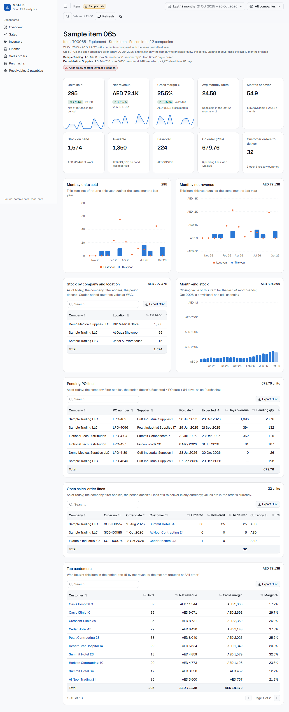

# MBAL BI

Business-intelligence dashboards for MBAL, built on **Orion**, MBAL's Oracle ERP. Orion is read
through the `MBALI.ZF_*_BI` views and is **read-only** for this app.

Stack: Next.js 16 (App Router) · React 19 · TypeScript (strict) · Tailwind CSS 4 · shadcn/ui
(Radix) · lucide-react · Recharts · TanStack Table · node-oracledb (thin mode, no Instant Client)
· Vitest + Testing Library · Playwright + axe · ESLint + Prettier · GitHub Actions.

| Page         | Route               | View                                                                                           | What it shows                                                                                                                                                                                                                                                                                                                                                                                                                                                                                                                               |
| ------------ | ------------------- | ---------------------------------------------------------------------------------------------- | ------------------------------------------------------------------------------------------------------------------------------------------------------------------------------------------------------------------------------------------------------------------------------------------------------------------------------------------------------------------------------------------------------------------------------------------------------------------------------------------------------------------------------------------- |
| Overview     | `/`                 | all of the above                                                                               | Executive overview: headline tiles per area linking to each dashboard with the filters kept (sales net revenue and GM %, net profit and net margin % vs last year; stock value and change vs last month-end, pending PO value and overdue % on orders from the last 2 years, AR outstanding and share over 90 days, AP outstanding, as of today); needs attention (overdue POs, AR over 90 days, 6-month dead stock, reorder alerts, each linking to its section); monthly sales vs last year and monthly P&L; a compact card per dashboard |
| Sales        | `/sales`            | `ZF_CSL_BI`                                                                                    | Net revenue, gross margin, margin %, invoices, returns, active customers, average invoice, discount (vs last year, with sparklines); monthly trend vs last year with partial months marked, growth % under each bar and yearly bars beyond 24 months; hover (or tap) a month or company bar for its breakdown by company, salesperson and item group; revenue by company, item group, salesperson; top 20 customers and items                                                                                                               |
| Product mix  | `/products`         | `ZF_CSL_BI`, `ZF_STK_SO_PO_SL_BI`                                                              | Net revenue, gross margin, items and brands sold (vs last year); brand → item treemap sized by net revenue and coloured by YoY, with zoom, a legend and a table (a ranked list on phones); top 10 growers, decliners, highest discount % and highest returns %, linking to the item pages. See [Product mix](#product-mix)                                                                                                                                                                                                                  |
| Inventory    | `/inventory`        | `ZF_CURR_STK_BI`, `ZF_STK_MTH_SUMM_BI`, `ZF_ITEM`                                              | Stock value, available and reserved value, stocked items and change vs last month-end, as of today; month-end trend (24 periods); stock value by company, item group, location and grade; dead stock (3/6/12 months, `?dead=`); reorder alerts                                                                                                                                                                                                                                                                                              |
| Finance      | `/finance`          | `ZF_F_T_DETAIL_BI`                                                                             | Revenue, cost of sales, gross profit and GP %, G&A, net profit and net margin % (vs last year); monthly P&L with partial months marked and revenue growth % under each bar; P&L statement by level_1 that expands to GL accounts; journal-line drill-down; unmapped-account total                                                                                                                                                                                                                                                           |
| Sales orders | `/sales-orders`     | `ZF_SO_BI`                                                                                     | Open order value, open orders and lines, delivered-not-invoiced and overdue value (as of today; orders placed in the last 2 years by default, `?since=12m\|all`, with what that leaves out); orders booked vs last year; open value by order age, salesperson and top 20 customers; monthly orders booked vs last year; open order lines (top 1,000, CSV); non-AED currency note                                                                                                                                                            |
| Snapshot     | `/snapshot`         | all of the above                                                                               | Preview of today's daily snapshot email, exactly as it would be sent (HTML and plain text); not in the sidebar. See [Daily snapshot email](#daily-snapshot-email)                                                                                                                                                                                                                                                                                                                                                                           |
| Purchasing   | `/purchasing`       | `ZF_PO_PENDING_BI`, `ZF_CPR_BI`                                                                | Pending PO value, open lines, overdue value and % (as of today; orders placed in the last 2 years by default, `?since=12m\|all`, with what that leaves out); receipts spend vs last year; pending value by aging bucket, top 20 suppliers and company; overdue PO lines (top 1,000, CSV); monthly receipts spend vs last year; top 20 suppliers by spend; zero-exchange-rate warning                                                                                                                                                        |
| Customer     | `/customers/[code]` | `ZF_CUSTOMER`, `ZF_CSL_BI`, `ZF_SOA_DETL_CUST_INV_SM_BI`, `ZF_SO_BI`                           | One customer: net revenue and GM % vs last year, AR outstanding and over 90 days, open order value; monthly revenue vs last year; top items; AR aging and open documents; open order lines; returns. Not in the sidebar: reached from the top-bar search (Ctrl/⌘+K) and the linked customer names in the dashboards. See [Customer page and search](#customer-page-and-search)                                                                                                                                                              |
| Item         | `/items/[code]`     | `ZF_ITEM`, `ZF_CSL_BI`, `ZF_CURR_STK_BI`, `ZF_STK_MTH_SUMM_BI`, `ZF_PO_PENDING_BI`, `ZF_SO_BI` | One item: units sold, net revenue and GM % vs last year, average monthly units and months of cover; stock on hand, available, reserved, on order (POs) and to deliver (orders), as of today; monthly units and revenue vs last year; stock by company and location; month-end stock; pending PO lines and open order lines (following the order-age choice, `?since=`); top customers; reorder badge. Not in the sidebar: reached from the search and the linked item names. See [Item page](#item-page)                                    |

## Setup

Needs Node 22 LTS (or newer) and npm.

```bash
npm ci
npm run dev            # http://localhost:3000, or $PORT if set
```

`PORT=4000 npm run dev` serves on port 4000 (PowerShell: `$env:PORT=4000; npm run dev`).

For production: `npm run build && npm start` (also honours `$PORT`). To run it for the team on
the office network, as a Windows service behind HTTPS with Microsoft sign-in, follow
[docs/deployment.md](docs/deployment.md).

## Data sources

### Sample mode (default)

No network or credentials needed. Data comes from synthetic CSV fixtures in `data/sample/`, and
every page shows a **Sample data** badge in the top bar. Every name in them is invented.

The same Oracle SQL runs on an in-memory SQLite database (Node's built-in `node:sqlite`) loaded
from the CSVs, so sample mode exercises the real queries. Sample dates are shifted by whole years
so the newest fixture year is the current year, so "year to date" always has something to show.
The receivables and payables fixtures are balances aged against today, so they shift by whole days
instead, until their newest document date is today. Month-end periods (`*_PERIOD`, `YYYYMM`) are
shifted by whole months so the newest is the current month.

### Oracle mode (live Orion)

Needs the office network or VPN. Set the variables below in `.env.local` (git-ignored) or in the
service environment, then start the app as usual:

```bash
MBAL_DATA_SOURCE=oracle
ORACLE_USER=...
ORACLE_PASSWORD=...
ORACLE_DSN=host:port/service_name
```

The app uses a connection pool with a 15 s connect timeout. If Orion can't be reached, or a query
fails, each section shows a short, friendly error with a **Retry** button instead of a stack
trace; details (Oracle error codes) go to the server log. An unreachable host shows the error in
about 17 s.

## Environment variables

| Variable                            | Required    | Meaning                                                                    |
| ----------------------------------- | ----------- | -------------------------------------------------------------------------- |
| `MBAL_DATA_SOURCE`                  | no          | `sample` (default) or `oracle`                                             |
| `ORACLE_USER`                       | oracle mode | Orion user                                                                 |
| `ORACLE_PASSWORD`                   | oracle mode | Orion password                                                             |
| `ORACLE_DSN`                        | oracle mode | Easy Connect string, `host:port/service_name`                              |
| `PORT`                              | no          | Port for `npm run dev` / `npm start`                                       |
| `AUTH_SECRET`                       | for sign-in | Random secret that encrypts the session cookie (32+ bytes)                 |
| `AUTH_MICROSOFT_ENTRA_ID_ID`        | for sign-in | Entra app registration: Application (client) ID                            |
| `AUTH_MICROSOFT_ENTRA_ID_SECRET`    | for sign-in | Entra app registration: client secret value                                |
| `AUTH_MICROSOFT_ENTRA_ID_TENANT_ID` | for sign-in | MBAL's Directory (tenant) ID; only accounts in it can sign in              |
| `AUTH_URL`                          | for sign-in | Public address, e.g. `https://bi.mbal.local` (http only for local testing) |
| `AUTH_ALLOWED_GROUP`                | no          | Entra group object id; only its members get in (empty: the whole tenant)   |
| `CRON_SECRET`                       | for cron    | Bearer token for `/api/cron/*`; empty rejects every call                   |
| `WARM_ON_START_URL`                 | no          | Warm-up called once at production start; default localhost:$PORT, `off`    |

Sign-in is on once the first four `AUTH_*` variables are all set. Without them sample mode works
exactly as before (no sign-in), `next dev` in oracle mode shows a warning banner, and `next start`
in oracle mode serves **no data**: every page shows "Sign-in is not configured" and the APIs
answer 503. Live figures are never served without sign-in.

The daily snapshot email adds these (see [Daily snapshot email](#daily-snapshot-email)):

| Variable                 | Required      | Meaning                                                                         |
| ------------------------ | ------------- | ------------------------------------------------------------------------------- |
| `CRON_SECRET`            | for the email | Bearer token for `POST /api/cron/snapshot` (see above); without it, 401         |
| `APP_URL`                | in production | Where the dashboards live, for the email's links (e.g. `https://bi.mbal.local`) |
| `SNAPSHOT_TRANSPORT`     | no            | `file` (default) or `graph`                                                     |
| `SNAPSHOT_DIR`           | no            | Folder the `file` transport writes to; default `./snapshots` (git-ignored)      |
| `SNAPSHOT_TO`            | `graph`       | Comma-separated recipients                                                      |
| `SNAPSHOT_FROM`          | `graph`       | Shared mailbox the email is sent as                                             |
| `SNAPSHOT_TENANT_ID`     | `graph`       | Entra ID tenant (directory) id                                                  |
| `SNAPSHOT_CLIENT_ID`     | `graph`       | App registration (client) id                                                    |
| `SNAPSHOT_CLIENT_SECRET` | `graph`       | App registration client secret                                                  |

There are no fallbacks for the Oracle settings: a missing one is reported on screen. They are read
on the server only (`import "server-only"`) and never reach the browser bundle. See
`.env.example`; never commit a real `.env`.

## Product mix

`/products` shows where revenue comes from and where it is growing or shrinking, on the same rows
as Sales (`where()` in `lib/server/queries/sales.ts`), so the date, company, salesperson and brand
filters all apply. The figures come from one query per period grouped by brand and **item code**
(`itemMixQuery`; names aren't unique, and grouping by name merges and splits codes), this period and
the same days last year, put together in `lib/server/product-mix.ts`.

- **Treemap:** brands, then the items of the selected brand. Area = net revenue; colour = YoY %
  against the same days last year on a diverging orange (fall) ← grey → blue (rise) scale with
  edges at ±5, ±15 and ±30% (`lib/product-mix.ts`, colours `--yoy-*` in `app/globals.css`).
  Items without sales last year are **new**, in a separate grey. The top 24 brands and each brand's
  top 30 items have their own tile; the rest are **All other brands** / **All other**, as are
  brands and items with no positive net revenue (they can't have an area). Unassigned is a brand
  like any other, so the tiles add up to Sales net revenue exactly. Tiles are focusable (Enter
  zooms or opens), and the table under the treemap holds the same rows; under 768 px a ranked list
  replaces both.
- **Watchlists**, top 10 each, per item code, with a minimum base of AED 10K (`MIN_BASE_AED`) so tiny
  items don't top them: **growers** and **decliners** by the change in net revenue in AED, among
  items with at least that much net revenue last year; **highest discount %** =
  `CSL_NET_DISC_VALUE` ÷ `CSL_GROSS_SL_VALUE` (as on the Sales discount card), among items with
  that much gross sales; **highest returns %** = the `SARTN` net value ÷ the `INV` net value (what was
  invoiced before returns), among items with that much invoiced.

## Customer page and search

`/customers/<code>` shows one customer, by their Orion code (`ZF_CUSTOMER.CUST_CODE`). Sales,
margin and returns follow the period; AR and open orders are as of today, as on their dashboards:
AR follows only the company filter, open orders also follow the salesperson and brand filters. The header shows the master's type, category, city and
parent, and the salesperson and credit limit from the customer's AR lines. An unknown code shows a
"Customer not found" state.

Every figure comes from the dashboards' own queries with the customer's code added as a bind
(`CSL_CUST_CODE`, `SDR_SUB_ACNT_CODE` and `H_CUST_CODE` are one code space on Orion), so a
customer's net revenue, AR and open order value equal their row on Sales, Receivables and Sales
orders. The AR sections stream in on their own Suspense boundaries, though one customer's AR takes
about 0.1 s on Orion. The AR documents (200), open order lines (1,000) and returns (200) tables are
capped, largest first, and say so.

**Search.** The search button in the top bar, or Ctrl+K (⌘K on a Mac), opens a dialog that finds
customers by part of their name or code, and items by part of their description or code
(`ZF_ITEM`), in separate groups, and opens the chosen page with the current filters.

```
GET /api/search?q=noor
→ { "ok": true, "data": [{ "kind": "customer", "code": "C0017", "name": "Al Noor Contracting 17", "detail": "SHARJAH" },
                         { "kind": "item", "code": "IT00065", "name": "Sample item 065", "detail": "Equipment" }] }
```

`q` needs at least 2 characters (400 otherwise), is only ever bound, and `%` and `_` match
literally. At most 20 customers and 20 items (one per item code), customers first, each best first
(exact code, then code or name prefix, then the rest by name); `kind` says which. Behind sign-in
like every other route.

**Links.** `DataTable` columns take a `linkKey`: the row field holding a link for that cell. The
customer names in Receivables top customers (grouped by code), Sales top customers, Sales orders
top customers and the open order lines link to the customer page. Sales and Sales orders group
customers by name, as reconciled; a name links only when one master code carries it. On Orion a
chain can have dozens of branch codes under one name, and its row adds them all up, so those rows
stay plain text.

## Item page

`/items/<code>` shows one item, by its Orion code (`ZF_ITEM.IM_ITEM_CODE`, encoded in the URL: codes
can hold `/`, `#`, `&` or spaces). Sales follow the period; stock, pending POs and open orders are
as of today; stock and POs follow only the company filter, open orders also follow the salesperson
and brand filters. The header shows the item group, stock and frozen
flags and the reorder planning fields (min, max, reorder level and quantity, lead time), per company
when the master's rows differ. An unknown code shows an "Item not found" state.

- **Months of cover** = available stock (on hand − reserved, all locations of the selected
  companies) ÷ the average monthly units sold over the last 12 months (net of returns, same
  companies). Shown as "No recent sales" when that average is 0 or below; no available stock is 0.
- **Units sold** = `SUM(CSL_QTY)` over the revenue rows (`INV` + `SARTN`). Orion puts the quantity on
  the delivery note and none on the invoice raised from it, so nothing counts twice.
- **Reorder badge**: shown when the item has a row in Inventory's reorder alerts (active item,
  available at a location at or below its reorder level).
- **On order** uses Purchasing's pending-line rule (`PO_CLO_STATUS = 0 AND PO_PEND_QTY > 0`), with
  expected date = PO date + 84 days; **to deliver** uses the open book of Sales orders (Closed orders
  out), in any currency since quantities add up across currencies. Order values are listed in the
  order's currency. Both follow the order-age toggle (`?since=`, last 2 years by default) as on
  Purchasing and Sales orders, and item links from those pages keep it.

Every figure comes from the dashboards' own queries with the item code added as a bind
(`CSL_ITEM_CODE`, `CS_ITEM_CODE`, `ZSL_ITEM_CODE`, `PO_ITEM_CODE` and `D_ITEM_CODE` are all
`IM_ITEM_CODE`s on Orion), so an item's stock value is its share of Inventory's and its net revenue
equals its row in Sales top items. Every section takes under about 1 s cold on Orion (the month-end
trend is the slowest), so none needed its own boundary beyond the usual one per section.

**Links.** Item names link to the item page in Sales top items and the customer page's top items
(grouped by name: linked when one master code carries the name, as for customers), Inventory dead
stock and reorder alerts, Purchasing overdue PO lines, Sales orders open lines and the customer
page's open order lines (all by code). Purchasing's top suppliers, receipts and the other charts
group by supplier or group, not item, so there is nothing to link there.



## Daily snapshot email

Every morning the manager gets MBAL's headline figures by email, without opening the app:

- **Sales:** yesterday's net revenue; month-to-date and year-to-date net revenue and gross margin %,
  vs the same period last year.
- **Finance:** year-to-date net profit and net margin %, vs last year.
- **As of today:** stock value and change vs last month-end, pending PO value and overdue %, AR
  outstanding and the share over 90 days, AP outstanding, open sales-order value and open orders,
  with the same currency notes as the pages. Pending POs and the order book count orders placed in
  the last 2 years (the dashboards' default order age) and their labels say so.
- **Needs attention:** the Overview's four items (overdue POs, AR over 90 days, 6-month dead stock,
  reorder alerts), each linking to its section.
- Every section links to its dashboard at `APP_URL`. The footer says when the data was read
  (Asia/Dubai) and whether it is **Live Orion** or **Sample data**.

All companies, dates in Asia/Dubai. The figures come from `overviewFigures()` in
`lib/server/overview.ts`, which calls the dashboards' own loaders with the same arguments as the
Overview (the Overview tiles use the same helpers), so the email equals the Overview's default
(year-to-date) view and `?range=mtd` for the same day. If one area's loader fails, that section says
**Not available today** (the reason goes to the server log) and the rest of the email still goes out.

**Preview:** `/snapshot` shows today's email exactly as it would be sent, with a plain-text tab. It
isn't in the sidebar; it is protected like every other page.

**Email HTML** (`lib/server/snapshot/email.ts`): a table layout, fluid up to 600px for phones and
Outlook on the web, with an Outlook-only (`<!--[if mso]>`) 600px table for Outlook desktop; inline
styles only; no scripts, images, external resources or web fonts; explicit background colours on
every coloured cell so Outlook's dark mode re-colours them legibly; a plain-text alternative built
from the same sections. Money is full AED from `lib/format.ts`.

### The endpoint

```
POST /api/cron/snapshot
Authorization: Bearer <CRON_SECRET>
```

The token is compared in constant time. A wrong or missing token gets **401** (so does every call
while `CRON_SECRET` is unset: the gate in `proxy.ts` refuses it before the route runs), `GET` gets
**405**, and a failed send **502** (logged with the step and Graph's error code, never a secret or
token). On success it answers `{ ok, date, subject, transport, recipients, files?, unavailable }`.
The route checks the token itself as well, so it stays safe even without the gate.

### Transports

`SNAPSHOT_TRANSPORT=file` (default) writes `snapshot-<date>.html` and `.txt` to `SNAPSHOT_DIR`
(`./snapshots`, git-ignored). CI, QA and the e2e tests use it.

`SNAPSHOT_TRANSPORT=graph` sends with Microsoft Graph `sendMail` as the shared mailbox
`SNAPSHOT_FROM`, to `SNAPSHOT_TO`. It gets an app-only token with the client-credentials flow and
sends the message as MIME, so it carries both the HTML and the plain-text alternative. Plain
`fetch`, no SDK. IT sets it up once:

1. **Shared mailbox:** create one to send from, e.g. `bi-reports@mbal.ae`.
2. **App registration** (Entra ID → App registrations → New): no redirect URI. Under _API
   permissions_ add Microsoft Graph → **Application** permission **Mail.Send** and grant admin
   consent. Under _Certificates & secrets_ create a client secret. Put the tenant id, client id and
   secret in `SNAPSHOT_TENANT_ID`, `SNAPSHOT_CLIENT_ID` and `SNAPSHOT_CLIENT_SECRET` (the service
   environment, never the repository).
3. **Limit it to that one mailbox.** Mail.Send as an application permission can send as _any_
   mailbox until it is restricted. In Exchange Online PowerShell:

   ```powershell
   # A mail-enabled security group holding only the shared mailbox
   New-DistributionGroup -Name "MBAL BI senders" -Alias mbal-bi-senders -Type Security -Members bi-reports@mbal.ae
   New-ApplicationAccessPolicy -AppId <SNAPSHOT_CLIENT_ID> -PolicyScopeGroupId mbal-bi-senders@mbal.ae `
       -AccessRight RestrictAccess -Description "MBAL BI snapshot: send only as bi-reports"
   # Check: the first says Granted, any other mailbox Denied (allow up to an hour to apply)
   Test-ApplicationAccessPolicy -AppId <SNAPSHOT_CLIENT_ID> -Identity bi-reports@mbal.ae
   Test-ApplicationAccessPolicy -AppId <SNAPSHOT_CLIENT_ID> -Identity someone.else@mbal.ae
   ```

   Exchange's newer RBAC for Applications (`New-ManagementRoleAssignment` with the
   `Application Mail.Send` role and a management scope) does the same job if IT prefers it.

4. Set `SNAPSHOT_TRANSPORT=graph`, `SNAPSHOT_FROM`, `SNAPSHOT_TO` and `APP_URL`, restart the app,
   and run `.\deploy\snapshot-task.ps1 -Run` once to check.

### Schedule

`deploy/snapshot-task.ps1` registers a daily Windows Task Scheduler job that POSTs to the endpoint
with the token. Run it in an elevated PowerShell on the server:

```powershell
.\deploy\snapshot-task.ps1 -WhatIf          # show what would be registered; changes nothing
.\deploy\snapshot-task.ps1                  # daily at 07:30 Asia/Dubai, POST http://localhost:3000/api/cron/snapshot
.\deploy\snapshot-task.ps1 -At 07:00 -Url https://bi.mbal.local/api/cron/snapshot
.\deploy\snapshot-task.ps1 -Run             # send now (needs CRON_SECRET in this shell)
.\deploy\snapshot-task.ps1 -Unregister      # remove the task
```

- The time is Asia/Dubai and is converted to the server's time zone when the task is registered. If
  the server's zone has daylight saving time the script warns: re-run it after a clock change, or
  set the server to Asia/Dubai.
- The task runs as `NT AUTHORITY\NETWORK SERVICE` (`-UserId` to change). It reads the token when it
  runs, from the machine-wide `CRON_SECRET` environment variable (the same value the app uses) or
  from `-SecretFile` (a file holding only the token, readable by that account). The token is never
  on the task's command line.
- A run that doesn't get HTTP 200 exits 1, so Task Scheduler's history shows it as failed. The task
  retries three times, ten minutes apart.

## Cache warm-up

`POST /api/cron/warm` (same `CRON_SECRET` bearer as the snapshot) loads the default view of the
Overview and of every dashboard (default date preset, all companies) through the pages' own
loaders, so the first visitor finds it in the cache instead of waiting for Orion (8-12 s for AR).
Results older than the run are re-read and waited for; visitors keep getting the cached ones
meanwhile. It answers with each section's time:

```json
{ "ok": true, "today": "2026-10-20", "startedAt": "…", "ms": 29263,
  "sections": [{ "page": "/", "section": "Receivables tiles, AR over 90 days", "ms": 12093, "ok": true }, …] }
```

502 (same body) means a section failed: its `message` is the one the page would show, the details
are in the server log. 401 without the right token, 503 while `CRON_SECRET` is unset.

`deploy/warm-task.ps1` runs it every 10 minutes from Task Scheduler (same options as the snapshot
script: `-WhatIf`, `-Run`, `-Unregister`, `-Url`, `-SecretFile`, plus `-EveryMinutes`). A production
server also warms once in the background when it starts (`instrumentation.ts`), never holding up
startup; set `WARM_ON_START_URL=off` to switch that off. See docs/deployment.md, "Scheduled jobs".

## Scripts

| Script              | What it does                                                |
| ------------------- | ----------------------------------------------------------- |
| `npm run dev`       | Dev server on `$PORT` (default 3000)                        |
| `npm run build`     | Production build                                            |
| `npm start`         | Serve the production build                                  |
| `npm run lint`      | ESLint                                                      |
| `npm run format`    | Prettier (`format:check` in CI)                             |
| `npm run typecheck` | Generate route types, then `tsc --noEmit`                   |
| `npm test`          | Vitest unit tests (guard, SQL numbers, binds, formatting)   |
| `npm run test:e2e`  | Playwright against the production build (run `build` first) |

`test:e2e` starts three servers: sample mode without sign-in on `E2E_PORT` (default 3100); oracle
mode with an unreachable DSN and sign-in configured with a dummy tenant on `E2E_ORACLE_PORT`
(default `E2E_PORT + 1`), for the sign-in gate, the cron token, health and the error card (tests
mint a session cookie with the test `AUTH_SECRET`, so nothing reaches Microsoft); and oracle mode
without sign-in on `E2E_LOCKED_PORT` (default `E2E_PORT + 2`), which must serve no data.
`E2E_SUITE=sample` runs only the first, `E2E_SUITE=oracle` the other two. CI runs everything in sample mode on every
push and pull request.

## How it fits together

```
app/
  layout.tsx            shell: sidebar + top bar (filters, refresh, theme, sample badge)
  page.tsx              Overview
  sales/page.tsx        Sales page: Suspense sections, one per card/chart/table
  sales/sections.tsx    async server components that load data and render the components
  purchasing/           Purchasing page and sections, same pattern
  finance/              Finance page, sections, P&L statement table and journal-line side panel
  api/finance/journal-lines/route.ts   GET endpoint the drill-down panel reads (shared filters)
  api/sales/breakdown/route.ts   GET endpoint the Sales hover card reads (one bar, shared filters)
  api/search/route.ts   GET endpoint the top-bar search reads (customers and items by name or code)
  customers/[code]/     the customer page (not in the sidebar) and its sections
  items/[code]/         the item page (not in the sidebar) and its sections
  api/health/route.ts   open health check: version, commit, data source, Orion ping (5 s)
  api/cron/             scheduled-job endpoints, Bearer CRON_SECRET instead of sign-in
  api/cron/snapshot/route.ts   POST endpoint that builds and sends the daily snapshot email
  api/auth/             Auth.js (Microsoft Entra ID) sign-in and callback
  sign-in/, no-access/, not-configured/   the pages shown before the dashboards
  snapshot/             preview of today's snapshot email (not in the sidebar)
  actions.ts            Refresh server action (clears the cache)
proxy.ts                the gate in front of every page and API (Next 16 middleware)
auth.ts                 Auth.js config: Entra ID, single tenant, group check, 10-hour sessions
deploy/                 Windows service scripts (install/update/uninstall, WinSW) and Caddyfile
components/
  dashboard/            KpiCard, ChartCard, TrendChart, PnlChart, BarBreakdown, DataTable, EmptyState,
                        ErrorCard, skeletons, PageHeader: reuse these in every dashboard
  shell/                sidebar, top bar, date-range picker, company select, search (Ctrl/⌘+K), URL filter state
  ui/                   shadcn/ui primitives
lib/
  dashboards.ts         the dashboard registry (sidebar + Overview are built from it)
  filters.ts            filters <-> URL query string, date presets, previous-year period
  format.ts             AED, number, percent and delta formatting
  notes.ts              currency notes shared by the pages and the snapshot email
  server/               server-only data layer
    access.ts           who may see what: sign-in on/off, locked mode, group and cron checks
    db.ts               runQuery(sql, binds): guard -> cache (stale-while-revalidate) -> oracle or sample
    warm.ts             the warm-up plan: every page's default sections, for /api/cron/warm
    guard.ts            read-only SQL guard
    errors.ts           DataSourceError and friendly Oracle error messages
    oracle.ts           node-oracledb pool
    sample.ts           SQLite sample source with Oracle shims
    sql.ts              filterWhere (binds), labelOrUnassigned, UNASSIGNED/ALL_OTHER
    chart-of-accounts.ts  reads data/chart-of-accounts.csv; unknown accounts are 'Unmapped'
    overview.ts         overviewFigures(): the Overview's figures, for the page and the snapshot email
    snapshot/           snapshot email builder (email.ts), file and Graph transports, token check
    queries/            one module per Orion domain (common.ts, sales.ts, inventory.ts, finance.ts,
                        purchasing.ts, ar-ap.ts, sales-orders.ts, customers.ts, items.ts)
data/sample/            sample fixtures, one CSV per view (plus FM_COMPANY and ZF_CUSTOMER)
deploy/snapshot-task.ps1  registers the daily snapshot as a Windows scheduled task
deploy/warm-task.ps1    registers the cache warm-up (every 10 minutes) as a Windows scheduled task
data/chart-of-accounts.csv  GL main account -> level_0/1/2 (finance owns it)
tests/unit, tests/e2e   Vitest and Playwright; tests/fixtures has the hand-checked CSV
```

### The data layer

Every query goes through `runQuery(sql, binds)` in `lib/server/db.ts`:

1. **Read-only guard.** Only a single `SELECT` or `WITH` statement passes. No `;`, and none of
   `INSERT UPDATE DELETE MERGE DROP CREATE ALTER TRUNCATE GRANT ...` anywhere in the text, even in
   comments or string literals. Reword the query or use a bind variable.
2. **Cache.** Results are cached in server memory keyed by data source + SQL + binds,
   stale-while-revalidate: up to 15 minutes old a result is served as is; up to 2 hours
   (`CACHE_MAX_AGE_MS`) it is still served at once while one background refresh, shared by every
   request, replaces it (a failed refresh keeps it and the next request retries); older than that
   the request waits for the source. At most 500 results (`CACHE_MAX_ENTRIES`), least recently used
   out first. Failures are never cached. **Refresh** in the top bar clears the cache; the top bar
   shows when the oldest data on screen was read ("Data as of"), stale results included. The
   warm-up job ([Cache warm-up](#cache-warm-up)) keeps the default views fresh.
3. **Source.** `oracle` (pooled node-oracledb) or `sample` (SQLite). Column names come back
   lower-cased either way.

Errors come out as `DataSourceError` with a `userMessage` that is safe to show. Sections use
`load(() => ...)` from `lib/server/errors.ts` and render `<ErrorCard message=... />` on failure.

Rules for query code:

- **Bind variables only.** Every user-chosen value (dates, companies, top N) is a bind. Use
  `filterWhere(filters, dateColumn, companyColumn)` for the shared filters. Dates are bound as
  `YYYY-MM-DD` strings and wrapped in `TO_DATE(:bind, 'YYYY-MM-DD')`.
- **Aggregate in SQL.** Never pull a fact table into JavaScript.
- Use `companyWhere(companies, companyColumn)` on views the date filter doesn't apply to (live
  stock, pending POs); it is `undefined` when every company is selected. Registry entries for
  dashboards where nothing follows the date filter set `dateFilter: false`, which hides the date
  picker.
- Show blank dimension values as `'Unassigned'` with `labelOrUnassigned(column)`; fold long tails
  into `'All other'` so totals still add up.
- Keep builders (`*Query(filters)` returning `{ sql, binds }`) separate from loaders, so tests can
  check the SQL and binds.

Speed on live Orion (from the live check in `docs/live-check.md`; aim for under 5 s per section):

- Several `ZF_*` columns are per-row lookups inside Orion's views (`ZF_SO_BI.H_CUST_NAME`, for
  one). Group by the code and attach names afterwards (from `MBALI.ZF_CUSTOMER`, `MBALI.FM_COMPANY`).
- Bound scans of the big views with a bind on the column itself (`ZSL_PERIOD >= :from_period`,
  `D_DT >= TO_DATE(:start_date, ...)`), never a function around the column.
- Don't filter a subquery's computed columns in an outer `WHERE` on `ZF_SO_BI`: Oracle's first plan
  for a new query text is then slow (~5 s, corrected only on the next run). Sum conditionally
  (`SUM(CASE WHEN ... THEN x ELSE 0 END)` with a `HAVING`) instead.
- The AR view (`ZF_SOA_DETL_CUST_INV_SM_BI`) takes 8-12 s whatever the query: it rebuilds every
  balance from the open-item ledger. Its sections stream in last.

### Portable SQL

Queries are written once in Oracle SQL and must also run on SQLite in sample mode. Stay within:

- `SELECT ... FROM MBALI.<VIEW> WHERE ... GROUP BY ... ORDER BY ...`, subqueries in `FROM` (give
  them an alias), `WITH`;
- `SUM`, `COUNT`, `COUNT(DISTINCT ...)`, `MIN`, `MAX`, `AVG`; `CASE WHEN`; `COALESCE`, `NULLIF`,
  `TRIM`, `UPPER`, `ABS`, `SUBSTR(x, start, length)`; `||` for concatenation; `ROW_NUMBER() OVER (ORDER BY ...)` and other window functions;
- `NVL(x, y)`, `TO_CHAR(date, 'YYYY-MM-DD' | 'YYYY-MM' | 'YYYY')` and
  `TO_DATE(:bind, 'YYYY-MM-DD')` (shimmed in `lib/server/sample.ts`);
- named binds (`:start_date`).

Date arithmetic doesn't port (Oracle subtracts `DATE`s, SQLite stores text): work out cut-off dates
in TypeScript and compare against them, as the aging buckets in `lib/server/queries/ar-ap.ts` do.

Avoid: `DECODE`, `TRUNC(date)`, `ADD_MONTHS`, `MONTHS_BETWEEN`, `SYSDATE`, `ROWNUM`, `FETCH FIRST`, `DUAL`, and
`GROUP BY` on an expression that contains a bind (Oracle raises ORA-00979; compute it in a subquery
and group by the alias). If a dashboard really needs another Oracle function, add a shim next to
the existing ones and a unit test.

### Filters and the URL

Filters live in the query string, so links are shareable and the back button works:

```
/sales?range=qtd&company=101,107
/sales?range=custom&from=2026-01-01&to=2026-03-31
```

`range` is `mtd`, `qtd`, `ytd` (default, left out of the URL), `12m` or `custom`. `company` is a
comma-separated list of company codes; absent means all. "Today" is today in Asia/Dubai. Pages read
them with `parseFilters(await searchParams, todayIso())`; client components use `useShell()`.

`salesperson` and `brand` are comma-separated codes too (`/sales?salesperson=S01,S07&brand=NW`),
validated and sorted like `company`; absent means all, and `_none` stands for Unassigned.
Salesperson is `ZF_CSL_BI.CSL_SM_CODE`. Brand isn't a column of the sales view: it comes from a
per-item map on `ZF_STK_SO_PO_SL_BI` (`lib/server/brand-map.ts`; why that source is in its header
and in `docs/live-check.md`), and items without a brand are Unassigned. The top bar lists only
salespeople and brands with sales in the selected companies and period (`GET /api/filter-options`),
except on two pages that list their own:

- **Inventory** follows the **brand** filter, through the same per-item map, on every figure: live
  stock, the month-end trend, dead stock and reorder alerts. Its choices are the brands of the items
  in live stock for the selected companies (`?source=stock`). Stock has no salesperson, so that
  control is disabled there.
- **Receivables & payables** follows the **salesperson** filter on AR only, on the customer's own
  salesperson (`SDR_CUST_SM_CODE`, the code space of `CSL_SM_CODE`), as the customer page shows it:
  the AR cards, aging, by salesperson, top customers and collection follow it; AP and the brand
  filter don't apply. Its choices are the salespeople with open AR (`?source=receivables`, from the
  page's own "Outstanding by salesperson" query), so salespeople without sales this year can be
  picked. The scope line says "(receivables only)" while one is set.

They reach SQL through the shared helpers, so a new query gets them for free: `where()` in
`lib/server/queries/sales.ts` for anything on `ZF_CSL_BI`, or `filterWhere(filters, date, company,
{ salesperson, item })` / `salesWhere(filters, { salesperson, item })` in `lib/server/sql.ts` for
another view with a salesperson code or an item code. Sales, Sales orders and the sales parts of
the Overview, customer and item pages follow them; Inventory follows brand and AR salesperson, as
above. A page whose data lacks one shows that control disabled, and when it is set the scope line
says it doesn't apply there. Set `salesFilters` on the registry entry (`lib/dashboards.ts`):
`{ salespeople, brands }` say which it follows, `only` names the figures that do when not all of
them do (the scope line adds it in brackets), and `options` where the choices come from (`sales`,
`stock` or `receivables`).

Under every page title the **scope line** says what the figures cover in one sentence, e.g. "Year to
date (1 Jan 2026 – 21 Oct 2026) · 2 companies · salespeople: 3 of 14 · all brands · compared with
the same period last year", so a screenshot explains itself (`components/dashboard/scope-line.tsx`).
Under 768 px all the filters move into a **Filters** drawer.

### Company logos

With exactly one company selected the sidebar shows that company's name and logo; with several or
all it shows "MBAL BI". No logos ship with the app. To add one, drop a square file named after the
company code into `public/logos/`: `public/logos/101.svg` or `public/logos/101.png` (an `.svg` wins
when both exist). It shows on the next page load, no restart needed. A company without a file gets
a monogram badge of its initials.

`since` is the **order age** of the two as-of-today order books, pending POs on Purchasing and the
open book on Sales orders: `2y` (orders placed in the last 2 years, the default, left out of the
URL), `12m` or `all` (`lib/order-age.ts`, read with `parseOrderAge`). The sidebar carries it from
page to page like the other parameters. Orion holds years of order lines that were received,
delivered or cancelled without being closed, so without it those books mostly measure old lines.
The "Orders placed" toggle under the KPIs sets it, and while it isn't `all` a line under the toggle
says how many lines, worth how much, it leaves out, with a **Show all** link. The Overview and the
daily snapshot always use the default and say so in their labels.

### Formatting

All money is AED (`lib/format.ts`): compact on cards and chart axes (`AED 1.2M`, `-AED 845K`), full
in tooltips and tables (`AED 1,234,567`). Negatives always carry a leading minus and tables colour
them. Changes vs last year are sign-aware: `-120` vs `-100` returns is shown as a fall.

Colours come from CSS variables in `app/globals.css` (`--chart-1..5`, `--positive`,
`--negative`, and the shadcn tokens), with separate light and dark values.

## Adding a dashboard

Say, Inventory on `ZF_CURR_STK_BI`:

1. **Queries:** `lib/server/queries/inventory.ts`, starting with `import "server-only"`. Write
   `*Query(filters)` builders returning `{ sql, binds }` (use `filterWhere`, stay within the
   portable SQL above) and loaders that call `run(query)` and return typed rows.
2. **Fixture:** add `data/sample/ZF_CURR_STK_BI.csv` with the real column names and invented
   values. It becomes the table `MBALI.ZF_CURR_STK_BI` in sample mode. For unit tests, add a tiny
   hand-checked CSV to `tests/fixtures/` and test the loaders against hand-computed numbers (see
   `tests/unit/sales.test.ts`).
3. **Registry:** add one entry to `DASHBOARDS` in `lib/dashboards.ts` (slug, title, description,
   lucide icon, source view). The sidebar and Overview pick it up.
4. **Page:** `app/inventory/page.tsx` and `app/inventory/sections.tsx`, copying the Sales pattern:
   parse filters, wrap each section in `<Suspense key=... fallback={<...Skeleton />}>`, load with
   `load(...)`, render `KpiCard`, `ChartCard` + `TrendChart`/`BarBreakdown`, `DataTable`,
   `EmptyState` and `ErrorCard`.
5. **Tests:** add the route to `PAGES` in `tests/e2e/helpers.ts` so it gets the console-error,
   mobile and axe checks.

### Hover and drill

Monthly charts get the Sales hover card and drill-down from two shared pieces:

- **Hover** (`components/dashboard/hover-breakdown.tsx`): a route that answers `{ ok, data }` for
  one bar (`?period=YYYY-MM` or `YYYY`, narrowed with `bucketFilters`; one aggregated query per
  period through `run`, so it is cached), and a `toView(data)` that returns a total, last year, any
  further figures (`lowerIsBetter` for costs) and a few labelled sections of rows. Pass
  `<HoverBreakdown>` as the chart's `renderTooltip` on wider screens and open `<HoverSheet>` from
  `onSelect` on phones. See `app/sales/charts.tsx` and `app/finance/pnl-drill.tsx`.
- **Drill** (`components/dashboard/drill-dialog.tsx`): the state lives in URL parameters of its own
  (`drill`/`doc` on Sales, `pnl`/`pnlLine`/`pnlAccount` on the P&L), so reloads and shared links
  keep it. `useOpenDrill` opens it from the chart's `onSelectMonth`/`onSelectBar` (bars become
  buttons: Enter opens, Esc closes and focus returns to the bar), `DrillView` loads a level on
  demand, `DrillTotals` and `DataTable` show it (totals row, CSV export, customer and item links
  through `linkKey`), and `DrillBack` goes up a level. Render the dialog once on the page.
- Test that the card and every level add up to the figure on the page for the same period and
  company (`tests/unit/pnl-drill.test.ts`).

The same pieces serve the other charts:

- **Inventory**, month-end stock value: the card is the month-end by company, brand and item group
  against the same month-end a year earlier (`/api/inventory/month-end?month=`); the drill
  (`?stockMonth=`) lists its items, linking to the item page (`/api/inventory/month-end-items`).
  Brand comes from the per-item map and item group from `ZF_ITEM.IM_GROUP_NAME`.
- **Receivables & payables**, AR and AP aging: the card is the column by company and by the
  customer's salesperson (AR) or the top 5 vendors (AP); balances have no last year, so the card
  leaves that row out (`HoverText.compare: false`). The drill (`?aging=ar-3`, `&agingAccount=`)
  lists the column's customers or vendors, then one account's open documents. Every AR query costs
  8-12 s on live Orion whatever it groups by, so the card and the first level read one cached
  aggregate (`arAgingCube`), started as the page renders and warmed by the cron job; only a
  customer's documents are read on demand, which is under 1 s narrowed to the customer.
- **Customer page**: the trend has partial months, growth and the Sales card narrowed to the
  customer, by company and item group (`/api/sales/breakdown?period=…&customer=`); the aging chart
  has the AR card narrowed to the customer. Neither has a drill-down.
- Tests: `tests/unit/stock-drill.test.ts`, `tests/unit/aging-drill.test.ts` and
  `tests/e2e/stock-aging-drill.spec.ts`.

## Business rules (Finance)

- Source `MBALI.ZF_F_T_DETAIL_BI`, one row per GL line. Period on `D_DT` (posting date), company on
  `D_COMP_CODE`.
- **Posted lines only:** `SUBSTR(TD_STATUS, 3, 1) = 'C'` (`PYC`, `CYC`). `CYU` is unposted. There is
  no `'P'` status.
- **Net amount** = `NVL(D_CREDIT_LC, 0) - NVL(D_DEBIT_LC, 0)`, in AED. Each line fills only one of
  the two columns, so both need the `NVL`.
- **Sign:** revenue sums positive and costs negative; net profit = revenue + cost of sales + G&A in
  those signed terms. Queries, loaders and tests keep that convention; only the screen shows costs
  as positive amounts.
- **P&L grouping** comes from `data/chart-of-accounts.csv`
  (`main_acnt, main_acnt_name, level_0, level_1, level_2`). `level_0` is `Profit and loss` or
  `Balance sheet`; P&L `level_1` is `Revenue`, `Cost of sales` or `General and admin expenses`.
  Orion is read-only, so the file is attached after the SQL aggregates by `D_MAIN_ACNT`, as a LEFT
  JOIN: an account missing from the file is **Unmapped**, never dropped. Unmapped postings are kept
  out of profit, listed in the P&L statement and totalled in a banner (shown only when non-zero).
  Finance can replace the file at any time; the server re-reads it when it changes.
- The shipped file was built from every account with posted lines in Orion (446 accounts, October
  2026), classified by code (1xxxx assets, 2xxxx liabilities and equity, 3xxxx revenue, 4xxxx
  costs) and name. Finance should review it, in particular which 4xxxx accounts are cost of sales.
- The drill-down shows the newest 500 posted lines of an account, with the count and totals of all
  of them.

## Business rules (Sales)

- Net revenue = `SUM(NVL(CSL_NET_SL_VALUE, 0))` over `CSL_TXN_TYPE IN ('INV', 'SARTN')`. Returns
  (`SARTN`) are already negative; the `SARTN` part of the sum is the returns figure.
- Cost = `SUM(NVL(CSL_WAC_VALUE, 0))` over the same rows; gross margin = net revenue − cost.
- `CSL_GROSS_SL_VALUE` (pre-discount) is never used as revenue.
- Invoices = distinct `INV` documents with a non-zero net value (zero-value delivery notes excluded).
- Blank customers, salespeople, item groups etc. show as **Unassigned**.
- Brand = the item's brand in `ZF_STK_SO_PO_SL_BI` (`"Brand"`, `"Brand_Name"`), joined on the item
  code; items it doesn't list are **Unassigned** (about 5.5% of revenue year to date). The TNS
  dashboard's "brand" was `CSL_GROUP_NAME`, which is our item group.

## Business rules (Receivables & payables)

Balances as of today; the company filter applies, the date filter doesn't. Both views hold open
**and** settled lines. Details and the live checks behind them are in the comment at the top of
`lib/server/queries/ar-ap.ts`.

- **AR** (`ZF_SOA_DETL_CUST_INV_SM_BI`): outstanding = `SDR_TOT_BAL − SDR_TOT_PDC` over open lines
  (|`SDR_TOT_BAL`| ≥ 1 AED). `SDR_TOT_BAL` is the open part of the AED amount (`SDR_ORG_LC_AMT`);
  settled lines keep a zero or a few fils of FX rounding. PDCs in hand are reported separately.
- Sales-attributed AR uses the customer's salesperson (`SDR_CUST_SM_CODE`); collection follow-up
  uses the finance salesperson (`SDR_FIN_SM_CODE`). The invoicing salesperson (`SDR_INV_SM_CODE`)
  is never used.
- **AP** (`ZF_SOAP_DETL_BI`): owed = `−SOAP_TOT_BAL − SOAP_TOT_PDC` over open lines (credit − debit
  on the open part; settled lines are exactly zero). Raw `SOAP_AMT_CR − SOAP_AMT_DR` is not used:
  settled lines keep stray amounts and part-paid lines show the full amount.
- Vendors are netted per company and sub-account. Vendors above zero make up AP outstanding and its
  aging; vendors below zero are **prepayments**, listed and totalled separately, never netted in.
- AP amounts are AED: the view is built from the ledger's local-currency columns, whatever the line's
  currency code (checked against the GL control accounts on live Orion).
- **Aging** on the document date (`SDR_DOC_DT`, `SOAP_DOC_DT`), always in this order:
  `<30 D` · `1-2 M` · `2-3 M` · `3-6 M` · `6-12 M` · `1-2 Y` · `2+ Y`. Under 30 days by days since
  the document, then whole calendar months (`lib/aging.ts`). "Over 90 days" = more than 90 days old.

## Business rules (Inventory)

- Live stock (`ZF_CURR_STK_BI`) has no `CS_AVAILABLE_QTY` / `CS_TOTAL_WAC*` columns; those are
  aliases from the old BI extract. Stock value = `CS_VAL`; available qty = `CS_UNCONF_QTY −
CS_RESV_QTY`; available value = available qty × `CS_WAC`; reserved value = the difference.
- `CS_GRADE` is space-padded: always `TRIM()` it.
- Item master (`ZF_ITEM`) joins on `(IM_COMP_CODE, IM_ITEM_CODE)` and is always a LEFT JOIN: about
  1% of stock keys have no item row and still count. `IM_FRZ_FLAG` is `Active` / `Freeze`;
  reorder alerts cover `Active` items with `IM_RORD_LVL > 0` whose available qty at a location is
  at or below it. `IM_ABC` is unmaintained and not used.
- Month-end stock (`ZF_STK_MTH_SUMM_BI`): `ZSL_PERIOD` is `YYYYMM` (`CHAR(6)`). The view has no
  opening quantity, so movement is closing qty minus the previous period's closing qty. The
  current month is provisional.
- Dead stock for N months = a company × location × item whose closing qty is the same, and above
  zero, in each of the newest N + 1 periods. Value at risk is their closing value.
- Month-end queries read only from a period bound worked out from today (the periods needed plus
  three months of slack), not the whole 8M-row view. Month-end lines below zero stay in the closing
  value and are noted under the trend.

## Business rules (Sales orders)

The open book (`ZF_SO_BI`) is **as of today**: the company, salesperson and brand filters apply,
the date filter doesn't.
It counts orders placed since the order-age cut-off (`?since=`, last 2 years by default): `H_DT` on
or after today moved back 24 (or 12) calendar months, worked out in TypeScript and bound as a date.
"Orders booked" follows both filters, on the order date `H_DT`, and ignores order age. Details and the live checks behind
them (October 2026) are in the comment at the top of `lib/server/queries/sales-orders.ts`.

- One row per order line, the `H_*` header columns repeated on each. The documented key
  `(H_COMP_CODE, H_TXN_CODE, H_TXN_NO, D_ITEM_CODE)` is **not** unique (an item can be on two lines
  of one order), so lines are never de-duplicated on it. An order is `(H_COMP_CODE, H_TXN_CODE,
H_TXN_NO)`.
- Statuses are words. **Closed** (`H_DOC_STATUS = 'Closed'`) is a cancelled or short-closed order;
  there is no `'C'` status. Closed lines keep their quantities, so they are left out of the open
  book, and only their delivered part counts as booked. Orders pending approval or submission are in
  the book.
- Pending delivery = `D_QTY − D_DELIVERED_QTY`, delivered not invoiced = `D_DELIVERED_QTY −
D_INVOICED_QTY`, each only when above zero (lines with `D_QTY > 0`). The quantities decide, not
  `H_DEL_STATUS`.
- Value = `D_FC_VAL`, the net line value (after line discount, before VAT and before the rarely used
  header discount). `D_TOT_VAL` includes VAT and isn't used. Pending value = `D_FC_VAL` × pending qty
  / `D_QTY`, pro rata, like pending POs.
- The view has no AED column or exchange rate: values are in the order currency `H_CURR_CODE`. AED
  totals cover AED orders only (99% of open lines); other currencies are listed in a note under the
  cards and still count in open orders and lines.
- Expected delivery `H_DEL_DT` is `DD-Mon-YYYY` text. `lib/orion-date.ts` reads it in TypeScript
  and builds the same conversion in portable SQL (`CASE` on the month name), so overdue (expected
  date before today) is worked out in SQL. In sample mode those dates move with the anchored ones.
- Order age uses the shared aging ladder on the order date. Blank salespeople and customers show as
  **Unassigned**.
- Open value by customer groups by `H_CUST_CODE` and takes the name from `ZF_CUSTOMER`
  (`H_CUST_NAME` is that same name, looked up per row, and too slow to group by).

## Business rules (Purchasing)

Pending POs (`ZF_PO_PENDING_BI`) are **as of today**: the date filter doesn't apply, the company
filter does, and so does the order age (`?since=`, last 2 years by default: `PO_DATE` on or after the
cut-off, bound as a date). Receipts (`ZF_CPR_BI`) follow both filters and ignore order age.

- A pending line is `PO_CLO_STATUS = 0 AND PO_PEND_QTY > 0`. `PO_CLO_STATUS` is a NUMBER
  (`0` = Open); comparing it to `'O'` raises ORA-01722. The view is pre-filtered to open lines but
  still holds fully received ones, hence the `PO_PEND_QTY` check.
- The live view has no `PO_PEND_LC_VAL` (or aging columns), whatever older docs say. Pending value
  (AED) = `(PO_LC_VAL − PO_LC_DISC) × PO_PEND_QTY / PO_QTY`, the line's net value pro rata to what
  is still to come. `PO_LC_NET_VAL` is not used: it is 0 on some lines with a value and no discount.
- Every pending-PO and open-book query is built on one line builder (`pendingLines`, `bookLines`)
  that applies the order-age cut-off. The KPI queries keep the older lines and flag them instead,
  so the same round trip gives the figures and what the cut-off leaves out.
- Expected date = `PO_DATE + 84` days. A line is **On Time** while that is in the future, else
  overdue by `today − expected date` days: `0-90`, `90-180`, `180-365`, `365+ Days Overdue` (lower
  bound inclusive, so 90 days overdue is `90-180`). The bucket edges are bound as dates, which keeps
  the SQL portable.
- Receipts spend = `SUM(CPR_LANDED_VALUE)`. Returns to supplier (`CPR_SIGN = −1`) are already
  negative and reduce spend.
- Non-AED receipt lines with `CPR_EXGE_RATE = 0` have their AED value zeroed. They are listed in a
  data-quality warning (count, recorded AED value, foreign-currency value) that only shows when
  there are any. AED lines with rate 0 are fine and not flagged.
